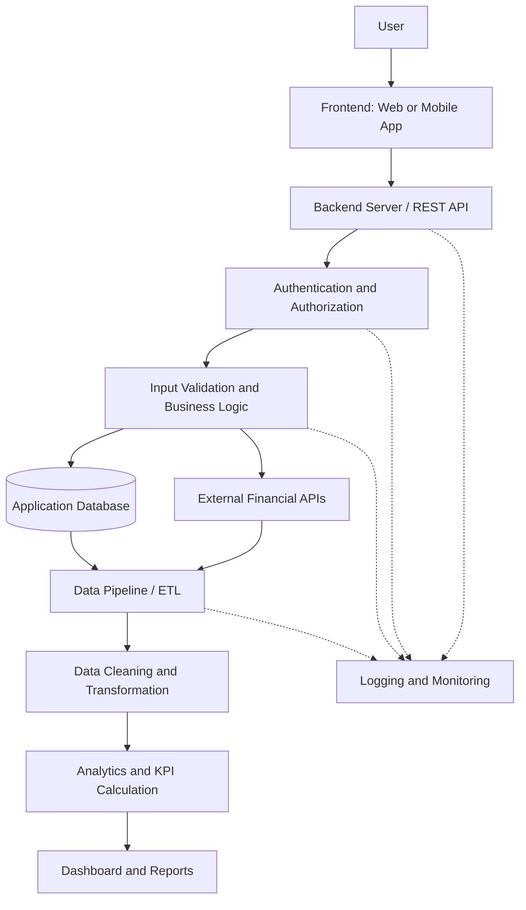

# FinTech Application — Software Architecture & Data Flow

## 1. Project Overview

This document explains the architecture of a typical FinTech application and illustrates how data moves from a user's interaction with the application through backend services, databases, data pipelines, and analytics dashboards.

The objective is to understand the core software development concepts used in financial technology applications and how they support secure data processing and business intelligence.

## 2. Software Architecture Diagram

## 3. Component Explanation

| Component | Description | Example in FinTech |
| --- | --- | --- |
| User | Person interacting with the application. | Investor checking a mutual fund portfolio. |
| Frontend | User-facing interface. | Web application or mobile banking app. |
| Backend Server | Processes requests and coordinates application logic. | Retrieving portfolio information. |
| REST API | Enables communication between software systems using HTTP. | Requesting fund information from a financial data service. |
| Authentication | Verifies the identity of a user or system. | Signing in to an investment platform. |
| Authorization | Determines which resources a user can access. | Restricting access to a user's own portfolio. |
| Input Validation | Checks incoming data before processing. | Validating an investment amount. |
| Business Logic | Applies application-specific rules. | Checking whether a requested transaction meets application requirements. |
| Application Database | Stores structured application information. | User profiles, portfolio records, and transaction history. |
| External Financial APIs | Supply data from external services. | Retrieving mutual fund NAV data. |
| Data Pipeline / ETL | Extracts, transforms, and loads data for analysis. | Collecting NAV history and preparing it for reporting. |
| Data Cleaning | Handles missing, duplicate, or inconsistent data. | Standardizing dates and validating NAV values. |
| Analytics | Calculates metrics and identifies patterns. | NAV trends, portfolio performance, and asset allocation. |
| Dashboard | Presents metrics and insights visually. | Power BI reports showing fund performance. |
| Logging and Monitoring | Records application events, failures, and operational information. | Detecting failed API requests or pipeline errors. |

## 4. Example Data Flow: Mutual Fund Analytics

Consider an investor who wants to view mutual fund performance in a FinTech application.

1. **User interaction:** The investor opens the application and requests mutual fund information.
2. **Frontend request:** The web or mobile interface sends a request to the backend.
3. **Authentication and authorization:** The application verifies the user's identity and permissions when protected information is requested.
4. **Request processing:** The backend validates the request and applies the relevant business rules.
5. **Data retrieval:** The application retrieves the required information from its database or an external financial API.
6. **Data ingestion:** A data pipeline collects the required records and stores the raw data.
7. **Data transformation:** The pipeline cleans the data, handles missing values, validates records, and prepares structured datasets.
8. **Analytics:** Python, SQL, or another analytics tool calculates relevant metrics, such as NAV changes and fund performance.
9. **Visualization:** A dashboard presents the results through charts, tables, and key performance indicators.
10. **Monitoring:** Logs capture relevant events and errors to help identify and resolve problems.

**Important:** This is a conceptual architecture. In a production application, data retrieval, processing, and dashboard refreshes may happen through separate services and scheduled pipelines rather than in one continuous request.

## 5. Core Software Development Concepts

### 5.1 Frontend and Backend

- **Frontend:** The part of an application that users interact with.
- **Backend:** The server-side component responsible for processing requests, applying business rules, and coordinating data access.

### 5.2 REST APIs

REST APIs allow applications to exchange information over HTTP.

Common HTTP methods include:

- `GET` — retrieve information.
- `POST` — submit information or create a resource.
- `PUT` — replace a resource.
- `PATCH` — partially update a resource.
- `DELETE` — request resource deletion.

The actual effect of a request depends on the API's implementation and permissions.

### 5.3 Authentication and Authorization

- **Authentication:** Verifies who is making a request.
- **Authorization:** Determines what the authenticated user or system is permitted to do.

Both are important for protecting financial information and restricting unauthorized access.

### 5.4 Databases

Databases store and organize information for applications.

Examples of financial application data include:

- User and account records.
- Mutual fund scheme information.
- NAV history.
- Portfolio holdings.
- Transaction records.

Access controls and appropriate data validation help maintain data integrity and confidentiality.

### 5.5 Data Pipelines and ETL

ETL stands for:

- **Extract:** Collect data from files, databases, or APIs.
- **Transform:** Clean, validate, standardize, and prepare the data.
- **Load:** Store the processed data in a destination suitable for analysis.

For mutual fund analytics, a pipeline might collect scheme information and NAV history, validate the records, and load the results into a database for SQL analysis and dashboard reporting.

### 5.6 Logging and Error Handling

Logging records important events and diagnostic information. Error handling allows software to respond appropriately when a request or operation fails.

Examples include:

- API request timeouts.
- Invalid or incomplete data.
- Database connection failures.
- Missing input values.
- Failed pipeline execution.

Logs should avoid exposing passwords, access tokens, or unnecessary sensitive financial information.

### 5.7 Software Development Life Cycle (SDLC)

The Software Development Life Cycle describes the major stages involved in developing and maintaining software:

1. Planning and requirements gathering.
2. System design and architecture.
3. Development and implementation.
4. Testing and validation.
5. Deployment.
6. Monitoring, maintenance, and improvement.

These stages help teams build reliable, maintainable applications.

## 6. Conclusion

A FinTech application combines user interfaces, backend services, APIs, databases, security controls, and data pipelines.

Data analytics adds business value by transforming raw financial information into meaningful metrics, trends, and visual insights. Understanding the complete data flow helps data analysts collaborate effectively with software developers, data engineers, and business teams.

This architecture provides a foundation for understanding how financial data moves from its source to a reporting dashboard.
